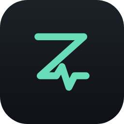

<p align="center">
  
</p>

<h1 align="center">Zoop for Android</h1>

<p align="center"><b>Your strap. Your data. Your phone. Offline, on-device, no cloud.</b></p>

<p align="center">
  
  
  
  
  <a href="LICENSE"></a>
</p>

<p align="center">
  
  &nbsp;&nbsp;
  
</p>

---

Zoop is an **Android-only fork** of [NOOP](https://github.com/ryanbr/noop), focused on the
**WHOOP 5.0 / MG** strap. The macOS, iOS and watch apps, the Swift packages, and the support for other
wearables (Oura, Polar, Garmin, Amazfit / Mi Band, generic heart-rate chest straps and FTMS gym machines)
have been removed. WHOOP 4.0 support is still in the code, but WHOOP 5.0 / MG is the default everywhere a
model has to be assumed.

## Contents

- [What Zoop is](#what-zoop-is)
- [Features](#features)
- [Build and install](#build-and-install)
- [How your data flows](#how-your-data-flows)
- [Privacy](#privacy)
- [Attribution](#attribution)
- [Disclaimer](#disclaimer)
- [License](#license)
- [Docs](#docs)

## What Zoop is

Zoop is an **offline-by-default, on-device** companion app for WHOOP straps. It pairs over Bluetooth,
stores everything in an on-device SQLite (Room) database, and computes recovery, strain, HRV and sleep
locally. There is no Zoop-operated server, no account, no cloud dependency and no telemetry.

## Features

| Screen | What it does |
|---|---|
| **Today** | Home dashboard: recovery, strain and sleep at a glance, stat tiles with sparklines, live strap battery and heart rate, recent workouts. |
| **Live** | Real-time heart rate and signal readout from the connected strap. |
| **Sleep** | Sleep sessions with a hypnogram, stage breakdown, efficiency, resting HR and HRV, computed on-device. |
| **Workouts** | Detected and manual exercise sessions with strain, HR zones and an HR curve. |
| **Trends / Explore / Compare** | Long-range trends, single-metric exploration and two-metric comparison. |
| **Health / Stress** | Biometric overview (HR, HRV, SpO₂, skin temperature, respiratory rate) and day-level stress. |
| **Breathe / Intervals** | Haptic breathing biofeedback and a silent haptic interval timer, driven by the strap's motor. |
| **Data Sources** | Import a WHOOP CSV export, Health Connect data or a nutrition CSV. |
| **Devices** | Pair and manage WHOOP straps (5.0 / MG by default, 4.0 also supported). |
| **Widgets** | Home-screen widgets for the day's summary, heart rate and stress. |

## Build and install

You need **JDK 17 or newer, up to 25** and the **Android SDK** (`platforms;android-35`, `build-tools;36.0.0`). Gradle is
provisioned by the wrapper, so do not install a system Gradle. Point Gradle at the SDK with
`android/local.properties` (`sdk.dir=…`) or `$ANDROID_HOME`.

```bash
git clone <this repository>
cd <repo>/android

# Debug build of the real app (the "Full" flavor):
./gradlew assembleFullDebug

# Install on a phone connected with USB debugging:
adb install -r app/build/outputs/apk/full/debug/app-full-debug.apk

# JVM unit tests (no phone or strap needed):
./gradlew testFullDebugUnitTest
```

Signing, release builds and pairing notes are in [`docs/BUILD.md`](docs/BUILD.md) and
[`docs/ANDROID.md`](docs/ANDROID.md).

## How your data flows

```
WHOOP 5.0 / MG ──BLE──▶ com.noop.ble ──▶ com.noop.protocol (decode)
                                                                   │
WHOOP CSV      ─┐                                                  ▼
Health Connect  ├─▶ com.noop.ingest (parse) ───────────▶ com.noop.data (Room / SQLite)
Nutrition CSV  ─┘                                                  │
                                                                   ▼
                                                    com.noop.analytics (recovery / strain /
                                                    HRV / sleep, on-device)
                                                                   │
                                                                   ▼
                                                    com.noop.ui (Jetpack Compose)
```

Every arrow stays on your phone.

## Privacy

**Offline by default.** Zoop has no server, no telemetry, and no account. Your strap data, imports,
and computed metrics live in a local SQLite database on your device. They leave only through an
export or optional network feature you deliberately configure, including the default-off
Experimental one-way push to your own endpoint; see
[`docs/PRIVACY_SECURITY.md`](docs/PRIVACY_SECURITY.md).

## Attribution

Zoop stands on community interoperability and protocol-documentation work. With thanks:

- **[`ryanbr/noop`](https://github.com/ryanbr/noop)** — the upstream project this fork is cut down from.
- **`johnmiddleton12/my-whoop`** — the WHOOP 4.0 BLE protocol.
- **`b-nnett/goose`** — the WHOOP 5.0 / MG BLE protocol documentation (the `fd4b0001-…` service family,
  CRC16-Modbus header, and "puffin" packet types) that Zoop's WHOOP 5.0 path is ported from.

Zoop contains no WHOOP proprietary code, firmware, logos, or assets, and performs no DRM circumvention.
Full detail in [`ATTRIBUTION.md`](ATTRIBUTION.md).

## Disclaimer

Zoop is an independent, unofficial, non-commercial interoperability project. It is
**not affiliated with, endorsed by, or connected to WHOOP, Inc.** All references to "WHOOP" are
nominative — used only to identify the third-party hardware Zoop interoperates with.

**Zoop is not a medical device.** Heart rate, HRV, recovery, strain, sleep stages, SpO₂, respiratory
rate, and skin temperature are **approximations** computed from published methods. They are not
clinically validated and are not medical advice. Do not use them to diagnose, treat, or make health
decisions — consult a qualified professional.

Provided **as-is**, with **no warranty**, for **personal and educational use**. You use it at your own
risk. Read the full notice in [`DISCLAIMER.md`](DISCLAIMER.md).

## License

Zoop is **source-available** under the [PolyForm Noncommercial License 1.0.0](LICENSE): free for
personal and other non-commercial use. Commercial use is not granted by this license. Keep the
[`LICENSE`](LICENSE) and `Copyright 2026 NoopApp` notice intact. Bundled dependencies keep their own
licenses (see [`NOTICE`](NOTICE)).

## Docs

- [`AGENTS.md`](AGENTS.md) — how to work on this repository (start here).
- [`docs/ANDROID.md`](docs/ANDROID.md) — the Android app in depth.
- [`docs/BUILD.md`](docs/BUILD.md) — building, signing and pairing.
- [`docs/PROTOCOL_WHOOP5.md`](docs/PROTOCOL_WHOOP5.md) and [`docs/PROTOCOL.md`](docs/PROTOCOL.md) — the
  WHOOP BLE protocol.
- [`docs/SCOPE.md`](docs/SCOPE.md) — which WHOOP-app features stay out of scope.
- [`CHANGELOG.md`](CHANGELOG.md) — upstream release history.
- [`DISCLAIMER.md`](DISCLAIMER.md) and [`ATTRIBUTION.md`](ATTRIBUTION.md).

Many files under `docs/` were written for the upstream multi-platform project and still mention the
Apple apps or other wearables. Treat those passages as historical; the Android code is the source of
truth.
